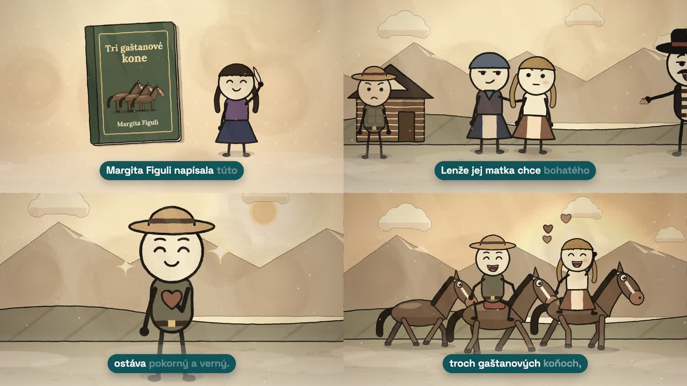

# maturitka-vids

Vysvetľujúce videá pre Maturitka Formalitka v štýle „atrament a akvarel“: paličkové postavičky na sepiovom papieri, slovenský hlas z Azure a teal titulky slovo po slove. Všetko je kreslené v kóde (canvas + Playwright + ffmpeg).



## Ako vyrobiť video s Claude Code

1. Naklonuj repo a otvor ho v Claude Code.
2. Prvýkrát spusti `tools/setup.sh` (Node, Chromium, Python prostredie).
3. Do `.env` doplň `AZURE_SPEECH_KEY` (Azure Speech, úroveň Free F0, región West Europe).
4. Napíš Claudovi obsah, napr.: *„Urob video o diele Maco Mlieč od Ľudmily Podjavorinskej.“*

Claude postupuje podľa skillu `.claude/skills/maturitka-video/SKILL.md`:
scenár na schválenie → hlas → scény → kontrolné zábery na schválenie → zvuk → hotové video vo `videos/<slug>/<slug>.mp4`.

## Čo je kde

| Cesta | Obsah |
|---|---|
| `docs/style-guide.md` | Celý vizuálny štýl, titulky, hlas a zvuk |
| `.claude/skills/maturitka-video/` | Skill: postup od obsahu po hotové video |
| `engine/` | Kresliaci engine: papier, atrament, svetlo, hmla, prechody, titulky, postavy, prostredie |
| `tools/` | `setup.sh`, `new-video.sh`, `vo_azure.py` (hlas), `stills.sh` (kontrolné zábery), `build.sh` (video) |
| `examples/tri-gastanove-kone/` | Hotový príklad (Tri gaštanové kone) |
| `captions/` | Pôvodný Remotion komponent titulkov z webu (`BubbleCaptions.tsx`) ako referencia |
| `samples/` | Ukážkové zábery štýlu |

## Ručne bez Clauda

```
tools/new-video.sh moje-video          # vytvorí videos/moje-video
# uprav videos/moje-video/script.json, shots.js, audio.py
cd videos/moje-video && ../../.venv/bin/python ../../tools/vo_azure.py && cd ../..
tools/stills.sh videos/moje-video 1,5,9,13
SKIP_VOICE=1 tools/build.sh videos/moje-video
```

Príklad: `tools/build.sh examples/tri-gastanove-kone`

## Licencie

Kód je pod MIT (engine je odvodený z [claude-animation-skills](https://github.com/artemnovitckii/claude-animation-skills), MIT). Fonty sú pod OFL. Hlas z Azure Speech sa smie použiť komerčne. VoiceStudio/OmniVoice nepoužívaj na zverejnené videá, jeho váhy sú len na nekomerčné použitie.
